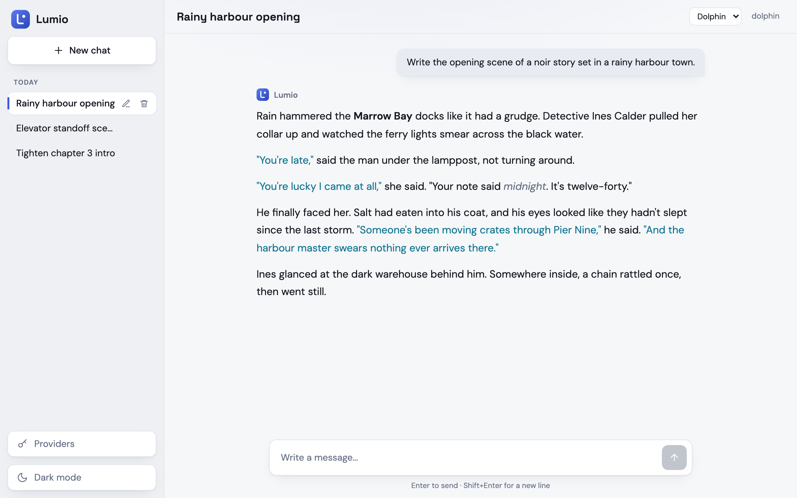
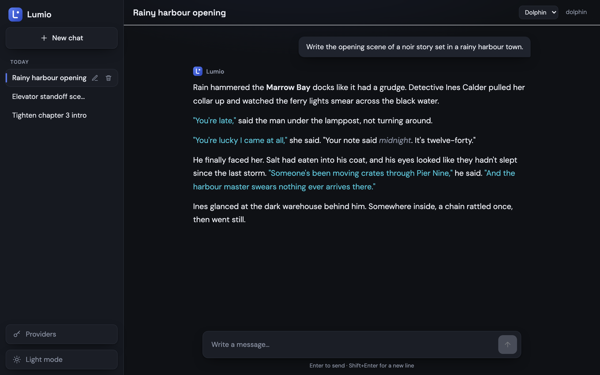

# Lumio

A local chat UI for xAI's Grok. Built for writing: dialogue, actions and key moments stay styled as the model streams its reply.

<p>
  
  
</p>

## Features

- Streaming Grok replies with Markdown, syntax highlighting and styled dialogue
- Image input: attach, paste or drop images and Grok reads them
- Optional web search: add a Tavily key to turn on the Web toggle; links you paste are always read
- Your xAI API key lives in the OS keychain, never in a file and never in the browser
- Saved chats with rename and delete, light and dark themes

Lumio still works with any OpenAI-compatible API: providers are profiles (name, base URL, model), switchable from the header.

## Setup

```sh
python3 -m venv .venv && .venv/bin/pip install -r requirements-dev.txt
cd frontend && npm install
```

## Run

```sh
make build   # build the frontend
make dev     # API + UI on http://localhost:8000
```

## Connect Grok

1. Create an API key in the [xAI console](https://console.x.ai).
2. In Lumio, open **Providers**, choose the **xAI (Grok)** preset (`https://api.x.ai/v1`, model `grok-4`) and paste the key.

For hot reload, run `npm run dev` in `frontend/` as well and open http://localhost:5173.

## Develop

`make check` runs the offline checks: syntax lint, ESLint, pytest and tsc.

**Stack:** FastAPI, React, TypeScript, Tailwind, Vite.
